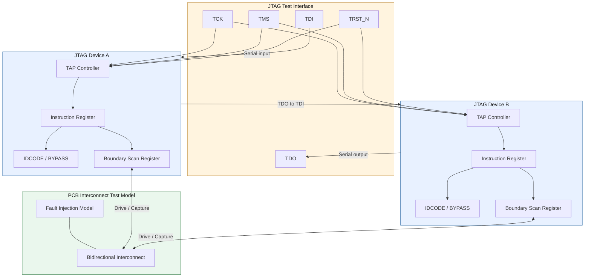

# IEEE 1149.1-Inspired JTAG Boundary Scan Architecture for PCB Interconnect Testing

## 1. Project Overview

This project implements a behavioral JTAG (Joint Test Action Group) Boundary Scan Architecture inspired by the IEEE 1149.1 standard for board-level interconnect testing.

The design uses Verilog HDL to implement a TAP (Test Access Port) controller, instruction and data registers, boundary scan cells, and a two-device JTAG daisy-chain architecture.

The project demonstrates how the EXTEST instruction can be used to drive test patterns through boundary scan registers, capture responses, and detect modeled PCB interconnect faults.

It also includes automated fault injection, exhaustive pattern sweeps for selected fault models, and a unified simulation regression system.

## 2. Key Features

- 16-state JTAG TAP controller.
- 4-bit Instruction Register.
- IDCODE and BYPASS data registers.
- Configurable Boundary Scan Register.
- Integrated JTAG top-level architecture.
- Two-device JTAG daisy-chain configuration.
- EXTEST-based interconnect testing.
- Bidirectional PCB interconnect model.
- Fault injection for:
  - Stuck-at-0 faults.
  - Stuck-at-1 faults.
  - Open-circuit faults.
  - Bridging faults using simplified wired-AND and wired-OR models.
- Automated fault pattern sweeps.
- Fault detection and coverage calculation.
- Unified regression script with generated reports.

## 3. Architecture

The design is organized into reusable JTAG components and a two-device board-level test architecture.


### JTAG Boundary Scan Architecture



Both devices share TCK, TMS, and reset signals. Device A's TDO connects to Device B's TDI, forming a serial JTAG daisy chain.

Their boundary scan outputs and inputs connect through a modeled bidirectional board interconnect.

## 4. RTL Implementation

| Module | Description |
|---|---|
| `tap_controller.v` | Implements the 16-state TAP FSM |
| `instruction_register.v` | Implements the 4-bit instruction register |
| `bypass_register.v` | Implements the single-bit BYPASS register |
| `idcode_register.v` | Implements the 32-bit simulated IDCODE register |
| `jtag_register_mux.v` | Selects the active data register TDO |
| `boundary_scan_cell.v` | Implements a reusable boundary scan cell |
| `boundary_scan_register.v` | Connects boundary scan cells into a serial register |
| `jtag_top.v` | Integrates the JTAG components |
| `jtag_board.v` | Connects two JTAG devices in a daisy chain |
| `board_interconnect.v` | Models bidirectional PCB connections |
| `jtag_board_extest.v` | Integrates JTAG EXTEST with board interconnects |
| `board_interconnect_fault.v` | Implements modeled interconnect fault injection |
| `jtag_board_extest_fault.v` | Integrates fault injection with JTAG EXTEST testing |

## 5. JTAG Instructions

The implementation uses a 4-bit instruction register.

| Instruction | Opcode | Function |
|---|---|---|
| EXTEST | `0000` | Tests external board interconnections |
| SAMPLE/PRELOAD | `0001` | Captures pin states and preloads boundary data |
| IDCODE | `0010` | Selects the 32-bit identification register |
| BYPASS | `1111` | Selects the single-bit bypass register |

The simulated IDCODE values are:

- Device A: `0x12345679`
- Device B: `0x87654321`

These are project-defined simulation values, not actual physical device identification codes.

## 6. EXTEST-Based Interconnect Testing

The EXTEST instruction enables the boundary scan registers to drive test patterns onto the modeled board interconnect.

The receiving device captures the resulting input values in its boundary scan register. These captured values are shifted out through the JTAG serial chain and compared against expected results.

The implementation verifies communication in both directions:

- Device A to Device B.
- Device B to Device A.

Test patterns such as `0xA5` and `0x5A` are used to verify normal interconnect operation.

## 7. Fault Injection and Detection

The project models four categories of interconnect faults.

| Fault Type | Description |
|---|---|
| Stuck-at-0 | Selected interconnect bit is forced low |
| Stuck-at-1 | Selected interconnect bit is forced high |
| Open circuit | Selected interconnect bit is modeled as high impedance (`Z`) |
| Bridging | Two selected bits are combined using simplified wired-AND or wired-OR behavior |

### Automated Fault Sweeps

The project includes automated testbenches that exercise selected fault locations in both directions.

| Fault Category | Test Cases | Detected |
|---|---:|---:|
| Stuck-at faults | 32 | 32 |
| Bridging faults | 112 | 112 |
| Open-circuit faults | 16 | 16 |
| **Total** | **160** | **160** |

### Fault Coverage

**Combined simulated fault coverage: 100%**

All 160 defined fault cases were detected in simulation.

This result applies only to the implemented fault models and tested patterns. It does not represent coverage of every possible physical PCB fault.

## 8. Simulation Results

The unified regression script executes seven major testbenches:

1. JTAG top-level integration.
2. Two-device JTAG board architecture.
3. EXTEST interconnect testing.
4. EXTEST fault detection.
5. Automated stuck-at fault sweep.
6. Automated bridging fault sweep.
7. Automated open-circuit fault sweep.

### Final Regression Summary

| Metric | Result |
|---|---:|
| Total testbenches | 7 |
| Passed | 7 |
| Failed | 0 |
| Fault cases tested | 160 |
| Faults detected | 160 |
| Undetected faults | 0 |
| Combined fault coverage | 100% |

## 9. Tools and Technologies

- **HDL:** Verilog
- **Simulation:** Icarus Verilog (`iverilog`, `vvp`)
- **Waveform Analysis:** GTKWave
- **Scripting:** Bash
- **Version Control:** Git and GitHub
- **Operating Environment:** Linux

## 10. Repository Structure

```text
JTAG_Boundary_Scan/
│
├── rtl/
│   ├── tap_controller.v
│   ├── instruction_register.v
│   ├── bypass_register.v
│   ├── idcode_register.v
│   ├── jtag_register_mux.v
│   ├── boundary_scan_cell.v
│   ├── boundary_scan_register.v
│   ├── jtag_top.v
│   ├── jtag_board.v
│   ├── board_interconnect.v
│   ├── jtag_board_extest.v
│   ├── board_interconnect_fault.v
│   └── jtag_board_extest_fault.v
│
├── tb/
│   ├── tb_tap_controller.v
│   ├── tb_instruction_register.v
│   ├── tb_bypass_register.v
│   ├── tb_idcode_register.v
│   ├── tb_jtag_register_mux.v
│   ├── tb_boundary_scan_cell.v
│   ├── tb_boundary_scan_register.v
│   ├── tb_jtag_top.v
│   ├── tb_jtag_board.v
│   ├── tb_board_interconnect.v
│   ├── tb_jtag_board_extest.v
│   ├── tb_board_interconnect_fault.v
│   ├── tb_jtag_board_extest_fault.v
│   ├── tb_jtag_fault_pattern_sweep.v
│   ├── tb_jtag_bridging_fault_sweep.v
│   └── tb_jtag_open_circuit_sweep.v
│
├── scripts/
│   └── run_jtag_regression.sh
│
├── reports/
│   └── jtag_regression_report.txt
│
├── sim/
├── waves/
└── .gitignore
```

Generated simulation executables, waveforms, and individual logs are excluded from version control.

## 11. How to Run

### Prerequisites

Install Icarus Verilog:

```bash
sudo apt update
sudo apt install iverilog gtkwave
```

### Clone the Repository

```bash
git clone <YOUR_GITHUB_REPOSITORY_URL>
cd JTAG_Boundary_Scan
```

### Run the Complete Regression

```bash
chmod +x scripts/run_jtag_regression.sh
./scripts/run_jtag_regression.sh
```

The script automatically:

1. Compiles each testbench.
2. Executes the simulations.
3. Checks testbench pass/fail results.
4. Extracts fault detection metrics.
5. Calculates combined fault coverage.
6. Generates a regression summary.

### View the Regression Report

```bash
cat reports/jtag_regression_report.txt
```

### View Waveforms

For example:

```bash
gtkwave waves/jtag_open_circuit_sweep.vcd
```

Other waveform files are generated in the `waves/` directory during simulation.

## 12. Project Limitations

- This is a behavioral, IEEE 1149.1-inspired architecture, not a complete certified IEEE 1149.1 implementation.
- The design is verified through RTL simulation, not physical PCB testing.
- The IDCODE values are simulated project values.
- Open circuits are represented using high-impedance (`Z`) modeling.
- Bridging faults use simplified digital wired-AND and wired-OR models.
- The reported 100% coverage applies only to the 160 defined simulated fault cases.

## 13. Future Improvements

- Extend instruction support and JTAG register functionality.
- Add configurable boundary scan chain lengths and pin mappings.
- Introduce additional fault models and more complex test patterns.
- Explore BSDL-based device configuration.
- Implement a hardware validation setup using compatible JTAG devices and physical interconnects.
- Extend fault coverage analysis and automated test generation.

## 14. Learning Outcomes

Through this project, I gained practical experience in:

- JTAG TAP controller design and FSM implementation.
- Boundary scan architecture and serial register chains.
- Verilog RTL design and modular hardware integration.
- Board-level interconnect testing using EXTEST.
- Fault injection and fault detection methodologies.
- Automated simulation, regression scripting, and coverage reporting.
- Git-based version control and project documentation.

---

**Note:** This project is an educational RTL implementation intended to demonstrate JTAG boundary scan concepts and simulated PCB interconnect fault detection.
